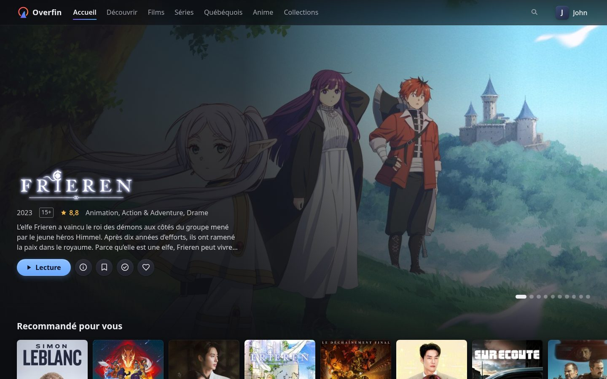
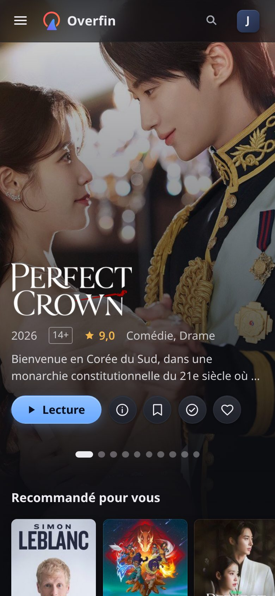
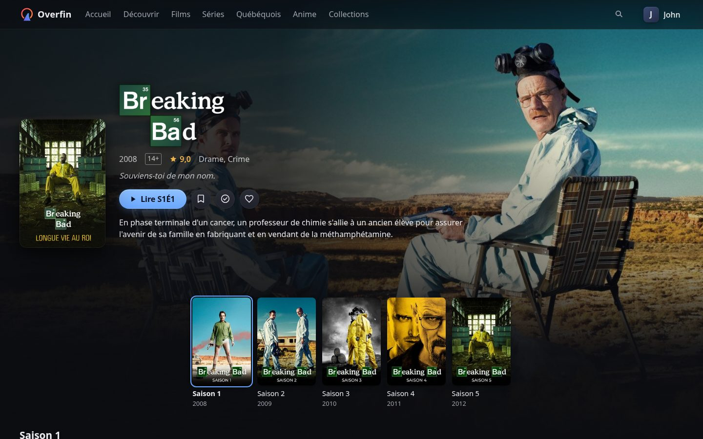
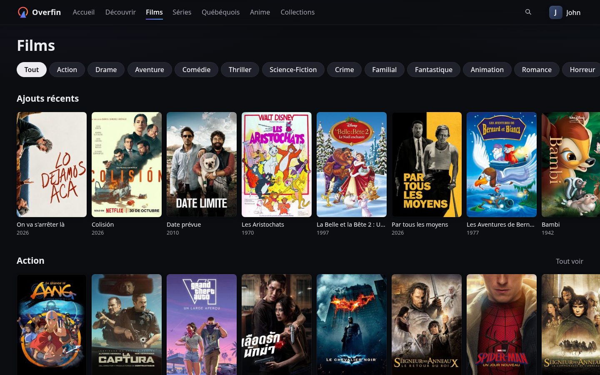

# Overfin

**Your own streaming service, on top of Jellyfin.**

Overfin puts a proper front door on your Jellyfin server: its own sign-in,
profiles, kids limits that hold, invitations, requests and a clean web app.
Share your library with family and friends without putting Jellyfin itself
on the internet, and without giving anyone a Jellyfin account.

Overfin comes with a Jellyfin of its own, in one compose file. Tell it where
your media is, start it, open it in a browser, and its setup wizard asks
for the rest.

```sh
mkdir overfin && cd overfin
curl -fsSLO https://raw.githubusercontent.com/overfin/server/v0.8.1/deploy/compose.yaml
curl -fsSL -o .env https://raw.githubusercontent.com/overfin/server/v0.8.1/deploy/.env.example
# in compose.yaml, change /srv/media to where your films and series are, then:
docker compose up -d
```

Then open `http://<the machine>`. Getting it on the internet with HTTPS,
behind your own proxy, with a Jellyfin you run yourself, or with your own
identity provider: see [Running it](#running-it).

<p>
  
  
</p>
<p>
  
  
</p>

## What you get

**For the people watching**

- **Signing in with their email** and a password. No Jellyfin account, no
  app to install.
- **Profiles**, each with its own history and an optional PIN. **Kids
  profiles** see only titles for their age, which the account's owner
  sets: a title's age comes from TMDB's ratings, those of the country you
  choose first, else the middle of other countries'. Everything else is
  hidden everywhere, not just greyed out, and can't be played. The owner
  can also keep any profile to some categories or libraries, or hide tags
  from it.
- **A catalog that looks the part**: posters, logos and backdrops from
  TMDB, cast pages, users' scores, search, trending and upcoming titles. A
  title your libraries don't have can be requested (with Seerr).
- **Watching in the browser**: played as is whenever the browser can,
  subtitles, audio tracks, quality choice, seek previews, skipping intros
  and credits (with Intro Skipper, which the setup offers to install), the
  next episode lined up, and picking up where they left off on any device.
- **Their language and their look**: each account picks its language among
  those you offer (the site, titles' names and synopses, emails), and each
  profile light, dark, or the device's.
- **Recommendations** for each profile on the home page, from what it
  watches and what its account said it likes, and **similar titles** on
  each title's page. Children's content shows in a profile's
  recommendations only when it's a kids profile or chose it ("Content for
  children").
- **Continue watching, a list (with a page of its own), favorites and
  watched marks** per profile; and the right to download what's kept about
  them, or delete it.

**For you, running it**

- **Overfin and its own Jellyfin, in one compose file**: Overfin sets
  Jellyfin up and keeps its settings, and nothing else talks to it. HTTPS
  by itself (Let's Encrypt) when you give it a domain, behind your own
  reverse proxy, or plain http on a LAN.
- **A setup wizard**, one step at a time: the default language, TMDB,
  Intro Skipper, Seerr, and you, its first admin.
- **Categories** of your own (Films, Series, Anime, Kids…), made from
  rules (films or series, genres, original language, library, tags, for
  ages up to, except other categories), each in the site's menu with its
  page, and on the home page if you like; the libraries can leave the
  menu. A template, or an account's owner, can keep profiles to some
  categories.
- **A control panel**: what's playing now (and stopping it), people and
  their accounts, notices (an account made, access ending, by email or
  webhook), invitations, templates (how many streams and profiles an
  account gets, whether each profile keeps a stream of its own, and the
  categories its profiles see), limits, languages,
  libraries, the GPU that converts videos (tested on your own files),
  seek-bar previews (off by default: they take time and disk space), email, Seerr, fixing titles Jellyfin matched wrong, what each title is
  worth to your server (Valuation).
- **Bringing people over** from another Jellyfin, their watch history
  included, with their old username and password, once. Nothing changes on
  that server.
- **Your own identity provider** instead of Overfin's sign-in, if you have
  one: OpenID Connect (Authentik, Pocket ID…) or a proxy's forward auth.
- **An API** for your own apps, and a key-protected one for tools such as
  Overtide: each title's value, from the weights you set (Valuation), its
  watch totals, and what to add next.

```
browser ──▶ the site (overfin-web, or your own)
   └──▶ /api/v1/*  ──▶  Overfin  ──▶  Jellyfin (private)
                          │
                          └──▶  its own sign-in, or your identity provider
```

Every app, official or not, talks to Overfin through the same public,
documented API, so a site or an app of your own can do everything the
official ones do, with total freedom on looks and feel. This repository is
the server; [overfin-web](https://github.com/overfin/web) is its web app.

## Where it stands

Overfin is young: it started in October 2026, its releases are early
pre-releases (0.x), and it's developed by one person with AI assistance.

- **It runs one real server**, every day, against Jellyfin 12, with its
  own sign-in. That is the extent of its real-world use so far.
- **Browser only.** There are no TV or phone apps yet, and Jellyfin's own
  apps don't go through Overfin: people who move to it watch in a browser
  (phones included).
- **Jellyfin 12 only.**
- **HTTPS by itself is new**: tested, but not yet run on a real domain.
  Behind a reverse proxy is the well-trodden path.
- **Releases are pre-releases.** Each comes as a signed image for x86 and
  ARM (`ghcr.io/overfin/overfin`). The API, the settings and the database
  can still change between versions; the database migrates itself.
- **Its security rules are written down and tested, but nobody outside the
  project has reviewed them yet.**

Try it, read it, build on it; don't make something you depend on rely on it
yet.

## What's missing

The main gaps (details in [ROADMAP.md](ROADMAP.md)):

- TV and phone apps, and a sign-in for native apps.
- Emails beyond accounts (confirming an address, a new password,
  invitations and notices about accounts are there).
- SDKs other than JavaScript.

The API specification also describes endpoints that aren't served yet; they
are marked `x-status: planned`.

## Running it

You need **Docker** with Compose, and your media on the same machine.
Overfin needs a **Jellyfin of its own** (Jellyfin 12): the compose file
runs one, which Overfin sets up by itself on its first start, and manages
from then on. A Jellyfin you already use stays yours and untouched: see
[Your own Jellyfin](#your-own-jellyfin).

**1. Start it** with the commands at the top. Your films and series are on
the media line of `compose.yaml` (`/srv/media:/media:ro`: the part before
the colon is where they are on this machine; Jellyfin only reads them).
[.env](deploy/.env.example) is optional: `OVERFIN_DOMAIN` (see below), and
your TMDB token as `OVERFIN_TMDB_TOKEN`, or give it in the wizard. On Fedora, RHEL and
other SELinux systems, add `,z` after `:ro` on the media line of
`compose.yaml`, so Jellyfin may read the folder.

Films and series in more than one place (another disk, a NAS share
mounted on the machine): add a line for each under Jellyfin's `volumes`
in `compose.yaml`, then `docker compose up -d`. In the control panel, a
library's folders are then the paths after the colon:

```yaml
    volumes:
      - /srv/media:/media:ro
      - /mnt/nas/films:/nas/films:ro
```

**2. Set it up in your browser.** Open `http://<the machine>`. The setup
wizard first asks for a one-time code, so nobody else can set up your
server before you do; this prints it:

```sh
docker logs overfin | grep -o '"code":"[^"]*' | tail -1 | cut -d'"' -f4
```

("permission denied": put `sudo` in front of `docker`, as for any Docker
command when your user isn't in the `docker` group.)

Then, one step at a time: the default language, a TMDB token (free; the
wizard says how to get one; for now the site can't be used without it),
Intro Skipper (optional), Seerr (optional), and your email and a password,
for you, its first admin.

**3. Add your libraries** in the control panel (`/admin/`, Libraries), with
folders under `/media`, where the compose file puts your media folder.

That's all. People sign in with their email and a password. In the
control panel: add people (People: an email and a first password, which
they change at their first sign-in), connect an email server (Server,
Email), make invitations (People, Registration: links anyone can register
with, confirming their email), choose your GPU (Server, Transcoding; the
compose file says how to give Jellyfin one). Without an email server,
there are no invitations or forgotten-password emails: you add people
yourself.

Overfin keeps its secret key in `overfin-secrets` and everything else in
`overfin-data`: back both up, apart. Jellyfin's data is in
`jellyfin-config`.

**Jellyfin itself** is closed: nobody signs in to it, and the compose file
publishes no port for it. To look inside, open access in the control panel
(Server, Jellyfin), and uncomment its `ports:` line, which publishes it on
the machine itself only (reach it through an SSH tunnel), or on your LAN
address. Changes made there may break Overfin, or be undone by it.

### Your own Jellyfin

To run Overfin alone, next to a Jellyfin you run yourself:

```sh
docker run -d --name overfin -p 8080:8080 \
  -v overfin-data:/data -v overfin-secrets:/secrets \
  ghcr.io/overfin/overfin:0.8.1
```

and give the wizard Jellyfin's address (or set `OVERFIN_JELLYFIN_URL`).
That Jellyfin must be **Overfin's alone**: Overfin sets the settings it
needs there, and sets them back on every start. A fresh Jellyfin, Overfin
sets up itself. One already set up, it takes only if you hand it over: the
wizard asks for one of its administrators' login, used once, shows what
that server holds, and waits for you to confirm it's dedicated to Overfin.
A Jellyfin people use directly is never a good fit: run a second one for
Overfin, on the same media folders.

### On the internet, with HTTPS

**Overfin can get its own certificate** from Let's Encrypt. Point your
domain at the machine, open ports 80 and 443, and run it with your domain:

```sh
docker run -d --name overfin -p 80:8080 -p 443:8443 \
  -e OVERFIN_DOMAIN=media.example.org \
  -v overfin-data:/data -v overfin-secrets:/secrets \
  ghcr.io/overfin/overfin:0.8.1
```

With the compose file, set `OVERFIN_DOMAIN` in `.env` instead: it already
publishes ports 80 and 443.

It renews the certificate by itself, and sends plain-http visitors to
HTTPS. The setup code keeps a fresh install yours, but do the setup right
away.

**Or behind your own reverse proxy**, which handles HTTPS and passes
everything to Overfin on port 8080. Tell Overfin the site's address and the
proxy's (with an `https://` address, Overfin's cookies are HTTPS ones, and
it tells browsers to come back over HTTPS only), in `/etc/overfin/overfin.toml`
([overfin.example.toml](overfin.example.toml) has every setting):

```toml
[site]
url = "https://media.example.org"

[identity]
trusted_proxies = ["198.51.100.7"]   # your reverse proxy: the client address comes from it
```

Caddy:

```caddyfile
media.example.org {
	reverse_proxy overfin:8080
}
```

nginx (inside your `server { listen 443 ssl; ... }` block):

```nginx
location / {
    proxy_pass http://overfin:8080;
    proxy_set_header Host $host;
    proxy_set_header X-Forwarded-For $remote_addr;
    proxy_set_header X-Forwarded-Proto $scheme;
    proxy_buffering off;              # video streams
    proxy_read_timeout 1h;
}
```

Traefik (labels on Overfin's container):

```yaml
labels:
  - traefik.http.routers.overfin.rule=Host(`media.example.org`)
  - traefik.http.routers.overfin.tls.certresolver=letsencrypt
  - traefik.http.services.overfin.loadbalancer.server.port=8080
```

**Your own client instead?** Set `[site] serve` to its folder: Overfin
serves it the same way, with the Content-Security-Policy you give it
(`csp`), and `spa_fallback = true` for single-page apps. With
`serve = "none"`, Overfin only answers `/api/`, and your proxy serves the
site, asking Overfin's gate first (`forward_auth` to `/api/v1/gate`) to keep
its pages private.

### Signing in through your identity provider

Instead of Overfin's own sign-in, people can sign in through an OpenID
Connect provider (`identity.mode = "oidc"`), such as Authentik or Pocket
ID, or a reverse proxy's forward auth (`"forwardauth"`).

By hand: make a confidential OpenID client at your provider with the
redirect URL `https://media.example.org/api/v1/auth/callback`, allowed to
issue refresh tokens (usually the `offline_access` scope), then:

```toml
[identity]
mode = "oidc"
trusted_proxies = ["198.51.100.7"]   # your reverse proxy

[oidc]
issuer = "https://auth.example.org/application/o/site/"
client_id = "overfin"
redirect_url = "https://media.example.org/api/v1/auth/callback"
```

with the client secret in `OVERFIN_OIDC_CLIENT_SECRET`. Anyone who can log
in at your provider gets an account, unless you set
`identity.required_group`, or make invitations required.

**Leaving your identity provider for Overfin's own sign-in?** While it's
still configured (with its `[connector]`), run `overfin -import-people`
once: everyone it has, with an email, can then sign in with that email,
keeping their account, and the panel's admins stay admins. Then switch to
`identity.mode = "managed"`. Imported people have no password yet: they
choose one with "Forgot your password?", or you set one in the panel.

**Locked out?** `overfin -set-password you@example.org` asks for a new
password and ends that account's other logins (with Docker: `docker exec
-it overfin /overfin -set-password you@example.org`).

### The control panel

With Overfin's own sign-in, it's at `/admin/` on the site, for admins, who
confirm it's them before going in. `[admin] private = true` keeps it to
private addresses (LAN, VPN); `[admin] listen = ":8081"` takes it off the
site entirely, onto a listener of its own for private addresses only
(publish that port on your LAN address only), where admins sign in at
`http://<that address>:8081/admin/`.

With an identity provider, it has a listener of its own instead, never on
the internet: publish its port on the server's `127.0.0.1` only, and reach
it through an SSH tunnel (`ssh -L 8081:localhost:8081 server`, then
`http://localhost:8081`), or on your LAN or VPN over HTTPS:

```toml
[admin]
listen = ":8081"
group = "overfin-admins"   # who may sign in, at your identity provider
redirect_url = "http://localhost:8081/admin/auth/callback"
```

For real names, add a `[connector]`. With Pocket ID (`kind = "pocketid"`,
`url = "https://auth.example.org"`), set `OVERFIN_CONNECTOR_TOKEN` to its
`STATIC_API_KEY`: Overfin then also sets up its own login client and the
admin group there, and invitation links lead to a one-person sign-up link
(Pocket ID needs `ALLOW_USER_SIGNUPS=withToken`). With Authentik
(`kind = "authentik"`), set it to an Authentik token of intent **API Token**
(not an app password), for a user allowed only to **view users**.

### Your brand, and your emails

**Branding** (control panel, Server, Branding) puts your site's name, logo
and banner in place of Overfin's: on the site, its sign-in page and its
emails. They're kept as you upload them, PNG or JPEG (not SVG, which emails
can't show); a banner for light pages is optional, for the sign-in page on
light screens (the site's header is dark on every page). With your brand, the
site and emails say "Powered by Overfin", discreetly. The control panel
stays Overfin's. The same page's **Home page** card chooses whether the
site's home page also shows titles no library has, to be requested (off by
default).

**Emails** are Overfin's own, in each person's language (confirming an
address, choosing a new password, invitations, the panel's test), in HTML
and plain text, with your brand when it's on. To write your own, put
templates with the same names in `mail-templates/`, next to the database
(`/data/mail-templates/` with Docker): any file there replaces Overfin's,
and the rest stay Overfin's.
Overfin's are the place to start, at the release you run:
[internal/emails/templates](internal/emails/templates).

- `layout.html` and `layout.txt` frame every email; `verify` (confirming
  an address), `reset` (a new password), `exists` (someone registered
  with an address that has an account), `invite`, `test`, the notices to
  admins (`joined`, `expiring`, `expired`) and the one to someone whose
  access ends (`ending`) are each email's own (`.html` and `.txt`). The
  subject is the `.txt` file's `subject` block.
- `reset.html` replaces it in every language; `reset.fr.html`, in
  French only; `reset.fr-CA.html`, in Canadian French only. Your own
  templates' languages are yours to cover.
- Templates are Go templates, with `.Site`, `.Lang`, `.Subject`, `.Link`,
  `.Name` and `.Date` (a notice's account, and when its access ends),
  `.Custom` (your brand is on), `.Banner` (`cid:banner`), `.Overfin`
  (Overfin's small logo, `cid:overfin`, with your brand on), `.Light` and
  `.Dark` (the theme's colors, such as `index .Light "accent"`), and `t`
  for Overfin's sentences in the reader's language (`{{t "reset.intro"}}`).
- They're read for every email: no restart. One that fails is reported in
  the log, and Overfin's is used instead. The panel's Emails card says
  whose each one is, and sends you a sample.

### Notices

Overfin can tell you about accounts: one made, one whose access ends soon,
one whose access ended. Never what anyone watches. All off until you
switch them on in the control panel (People, Notices): tick the events,
how many days before an end date to tell (7 by default), and where they
go: the admins' email, a webhook, or both. "Email the person" also warns
someone, in their language, before their access ends. Emails need
Overfin's own sign-in and an email server (Server, Email). "Send a test"
sends one where the page says, saved or not. End dates are checked every
hour; a notice about one is sent once per end date, and one that fails is
logged, not sent again.

The webhook gets a JSON `POST` (no redirects followed, 10 seconds at most),
with the event in an `X-Overfin-Event` header too:

```json
{"event": "account.expiring",
 "content": "…", "text": "…", "allowed_mentions": {"parse": []},
 "account": {"id": "acct_…", "name": "…"},
 "expiresAt": "2026-11-30T00:00:00Z", "at": "2026-11-23T14:00:00Z"}
```

`event` is `account.joined`, `account.expiring`, `account.expired`, or
`test` (with no `account`). `content` and `text` are the notice in words,
what Discord's and Slack's webhooks show, so their webhook addresses work
as they are; `allowed_mentions` keeps Discord from pinging anyone.
`account.name` is the label you gave the account, else the person's email
(with Overfin's own sign-in), else its owner profile's name. `expiresAt`
is there when the account has an end date.

**Signing**: "Sign the posts" makes a key, shown once. Each post then
carries `X-Overfin-Signature: sha256=` and the HMAC-SHA256 of the body, in
hex, with that key (the bytes its hex stands for). Check it against the
body exactly as received. In a shell, with the body in `body.json`:

```sh
KEY=…   # the key the panel showed
echo "sha256=$(openssl dgst -sha256 -mac HMAC -macopt hexkey:$KEY < body.json | sed 's/.*= //')"
```

In Go:

```go
func signed(body []byte, header, key string) bool {
	k, err := hex.DecodeString(key)
	if err != nil {
		return false
	}
	mac := hmac.New(sha256.New, k)
	mac.Write(body)
	want := "sha256=" + hex.EncodeToString(mac.Sum(nil))
	return hmac.Equal([]byte(header), []byte(want))
}
```

"Make a new key" replaces it: the old one stops matching at once.

### Moving people over from Jellyfin

Switch migration on in the control panel and give it your other Jellyfin's
address, let everyone sign in (with Overfin's own sign-in, add them in the
panel or invite them; with an identity provider, give them a login there),
and announce it. On their first visit, people choose to bring their history
and enter their old username and password once: what they watched, where
they stopped and their favorites are copied into their new account. Nothing
changes on your other server, so both can run side by side for as long as
you like.

Overfin never names Jellyfin to the people using your site: speak of their
"previous account", or your old service's name.

## Features

Everything is built in. Accounts and profiles, the library, playback and the
watchlist are always on; the rest is switched on in the control panel.

| Feature | Offers | |
| --- | --- | --- |
| Library | Browsing, images | Always on |
| Playback | Watching, subtitles, limits | Always on |
| Watchlist | Each profile's watchlist | Always on |
| Invitations | Invitations and invite templates | Always on |
| Migration | Bringing Jellyfin accounts over | Switch |
| Catalog | The library's index, matched to TMDB | Always on |
| Discovery | Trending, popular and upcoming titles, from TMDB | With a TMDB token or Seerr; kids profiles see what their age allows |
| Requests | Asking for titles no library has, through Seerr | When Seerr is connected |

Everything people see about a title, its text and its images, comes from
TMDB, in each account's language. For that, Overfin needs **your own TMDB
token** (TMDB's "API Read Access Token": free, and the setup wizard says
how to get one), given in the wizard, the control panel (Server, TMDB) or
`OVERFIN_TMDB_TOKEN`. No token is shipped with Overfin: each server uses
its own. For now, Overfin can't do without one: titles show with no name
or picture, Home stays empty, there's no discovery, and kids profiles see
nothing, since titles' ages come from TMDB's ratings. Running on what
Jellyfin knows alone is planned.

Overfin asks TMDB by itself, by title, never saying who's asking; browsers
never contact TMDB. It keeps TMDB's data as its terms allow (five months at
most), and overfin-web shows TMDB's attribution. The pictures of the
titles your libraries have are kept on disk ahead of time, in `artwork/`
next to the database, so browsing the library never waits for TMDB; the
others are fetched when first shown. TMDB's free API is for non-commercial
use: a site that charges for access needs TMDB's commercial terms. Seerr,
when connected, is a second source, and takes requests.

Each account asks Seerr through a Seerr user of its own, which Overfin makes
and names after the account (the name the control panel shows), so Seerr's
pages say who asked for what. Seerr's own settings give those users their
permissions, auto-approval and quotas. No one signs in to Seerr as them, and
people never need Seerr itself: keep it private on your network, reachable
by Overfin and you only.

## Other apps

Other apps can read some of what Overfin knows, with a key you make for
each in the control panel's **Apps** tab (shown once, revocable), for what
you tick: each title's **value** (the Valuation tab's score, 0 to 100),
its **watch statistics**, and whether the libraries have it (**in the
libraries**). Totals per title only, never anything per person; counts
below 2 are given as 0, and so are plays and favorites when fewer than two
people account for them, so none points at one person. Apps ask the control
panel's address (the site's, or its own private listener when you gave it
one):

```
GET /apps/v1/titles?inLibrary=true&sort=score&order=asc&limit=100
Authorization: Bearer ofapp_…
```

```json
{"titles": [{"kind": "season", "name": "Game of Thrones", "tmdbId": "1399", "tvdbId": "121361", "imdbId": "tt0944947",
  "season": 2, "score": 41.5, "inLibrary": true,
  "stats": {"plays": 12, "viewers": 3, "favorites": 2, "lastPlayed": "2026-10-20"}}],
 "next": "100", "generatedAt": "…"}
```

One row per film and per season (a season carries its series' IDs), with
the groups the key may read, or those named in `fields` (`score`, `stats`,
`availability`). Filters: `inLibrary`, `kind` (`movie` or `season`),
`list` (`trending` or `popular`: the titles in TMDB's list, in its order
unless `sort` is given, films and series side by side by their place; a
season by its series' place; or `suggestions`: the titles the libraries
lack and that are out (or out within two days), in the order an app
should add them, the most valuable first with trending and popular titles
mixed in by the **Discovery share** set on the Valuation tab; never sorted
otherwise).
Sorting: `sort=score` (keys with the value only) or `name`, `order=asc` or
`desc`. Pages of `limit` rows (100 by default, at most 1000); the next one
at `cursor=` what `next` says. An app that frees space (such as Overtide)
asks for the least valuable titles the libraries have, as above, and
for `list=suggestions` to know what to add.

The older endpoint, for keys made for watch statistics before, still
answers:

```
GET /apps/v1/watch-stats[?since=2026-10-22T00:00:00Z]
Authorization: Bearer ofapp_…
```

```json
{"titles": [{"kind": "series", "tmdbId": "1399", "tvdbId": "121361", "imdbId": "tt0944947",
  "plays": 12, "viewers": 3, "favorites": 1, "lastPlayed": "2026-10-20", "changedAt": "…"}],
 "generatedAt": "…"}
```

`plays` are plays to the end (a series adds up its episodes), `viewers`
the accounts that watched some of it, `favorites` the profiles that keep
it as a favorite. Only titles at least two people watched are listed,
and `changedAt` is only the day (midnight UTC). With `since`, only the
titles changed on that day or later.

## Building your own client

- **The API**, specified in [api/openapi.yaml](api/openapi.yaml), with its
  conventions at the top. Errors are typed problem details.
- **The JavaScript SDK**, [sdk/js](sdk/js): one ES module, no dependencies,
  TypeScript types, and a player that handles progress, recovery and
  takeovers.
- **overfin-web**, in
  [its own repository](https://github.com/overfin/web): Overfin's own
  web app, in Svelte and TypeScript on the SDK, bundled by the official
  build and served by default. It's what the real server runs, and it uses
  nothing but the public API, like any client.

## Security

Overfin treats every browser as untrusted and Jellyfin's data as untrusted
input. Among its rules: every route is declared (no passthrough to
Jellyfin), Jellyfin tokens never reach the browser and are encrypted at
rest, Overfin reaches Jellyfin as one locked-down account and decides
itself what each profile may see, images are
re-encoded, nothing is collected for analytics, and between Overfin servers (planned
sharing) nothing is ever trusted by default. What depends on your setup
(HTTPS, where the control panel answers) has a secure default you may
relax for your own server.

The rules are in [SECURITY.md](SECURITY.md), the threats they answer in
[THREAT_MODEL.md](THREAT_MODEL.md). Remember they haven't been reviewed by
anyone outside the project yet.

## Development

```sh
go test ./...
node --test sdk/js/overfin.test.js
go run ./cmd/overfin -config overfin.toml
```

Your own build in the compose stack: `docker build -t overfin:dev .` in the
repository, then `OVERFIN_IMAGE=overfin:dev` in the .env beside compose.yaml and
`docker compose up -d`.

Go with the standard library and three dependencies (a TOML parser, a
pure-Go SQLite, and the Go team's golang.org/x/crypto for getting
certificates from Let's Encrypt), besides overfin-web, which the official
build bundles. CI runs formatting, vet, staticcheck, govulncheck, the tests
with the race detector, and a check that the API specification matches the
routes.

Useful to know: `overfin -check` tests the configuration and what it points
to (the secret key, Jellyfin, the identity provider) and says in plain words
what's wrong, changing nothing; `SIGHUP` reloads the configuration without dropping
playbacks; API requests that take over 300 ms (streams aside) are logged (`a slow request`,
with the route's pattern and the time only, never who asked or for what),
to see where speed is lost; `-recover-tokens` gets you going again if the secret key is lost
(PINs and logins are reset, history is kept; TMDB's token, Seerr's key and
the SMTP password set in the panel are given again there, and pending
registrations start over). It asks you to hand Overfin's Jellyfin over
again, with an administrator's login, which nobody has once Overfin took
it: Jellyfin's own "forgot password" gives one back, from its network.
`POST /Users/ForgotPassword` with `{"EnteredUsername":"overfin-admin"}`
writes a PIN to a `passwordreset*.json` file in Jellyfin's config folder;
`POST /Users/ForgotPassword/Pin` with `{"Pin":"…"}` makes that PIN the
password. `-recover-tokens` prints these steps too.

## AI-assisted development

Said plainly: Overfin is written by Claude (Anthropic's AI): its code, its
tests and its documentation. The maintainer gives directions (what to build,
how it should behave, what to change) and uses Overfin day to day, on a real
server with a real library, but doesn't write the code or review it line by
line. Commits Claude wrote carry a `Co-Authored-By: Claude` trailer.

What checks the code is what runs before every push: the tests, vet,
staticcheck and govulncheck; and the rules in [SECURITY.md](SECURITY.md)
and [THREAT_MODEL.md](THREAT_MODEL.md), written down so the code can be
checked against them. That isn't an independent security review, and
Overfin hasn't had one yet: reviews and reports are very welcome.

## License

[MIT](LICENSE). overfin-web, which the official build bundles, includes
[hls.js](https://github.com/video-dev/hls.js), unmodified, under the Apache
License 2.0.

Overfin is an independent project, not affiliated with or endorsed by the
Jellyfin project, Seerr or TMDB.
