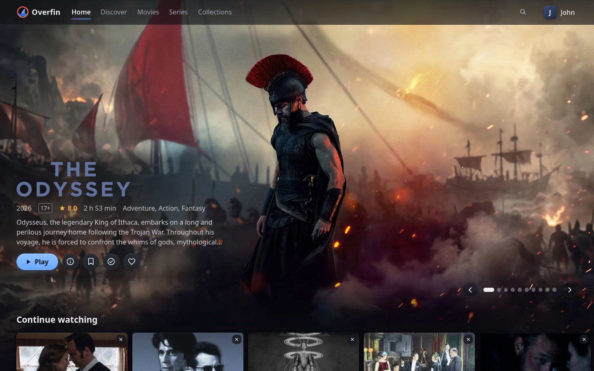
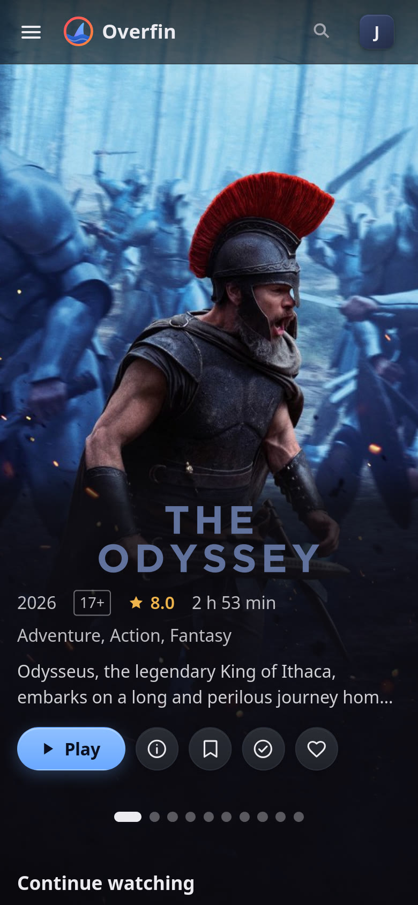
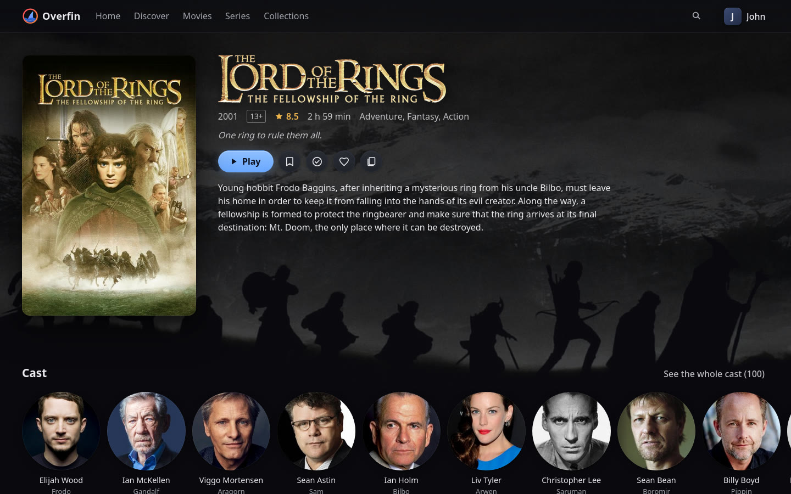
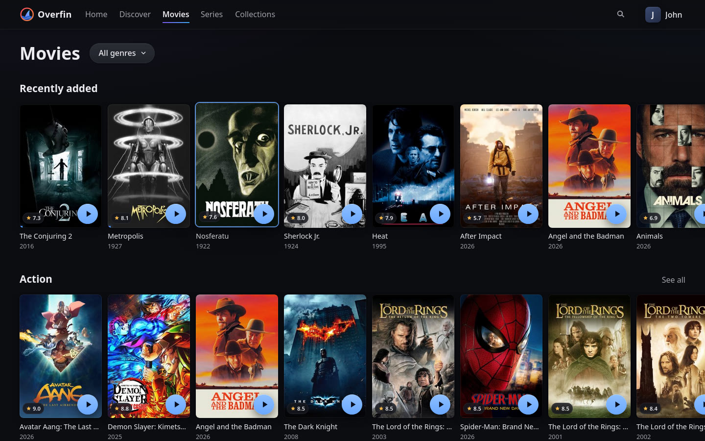

# Overfin

**Your own streaming platform.**

Overfin is a complete streaming service you run yourself: sign-in by email,
profiles, kids limits that hold, wishlists, a fast web app and an Android
app, and servers that can share their libraries with each other.
Underneath, it runs its own Jellyfin, used only as the engine that reads
and converts your files. Nobody sees it, and nobody needs an account on it.

**Pair your server with your friends' servers**, and their libraries show
on your site beside yours, playable with the sign-in your people already
have: [federation](#federation).

<p>
  
  
</p>
<p>
  
  
</p>

## Try it

Run it on the machine that has your films and series, or can reach them through
a mounted network share. It needs Docker with Compose:

```sh
mkdir overfin && cd overfin
curl -fsSLO https://raw.githubusercontent.com/overfin/server/v0.9.0/deploy/compose.yaml
curl -fsSL -o .env https://raw.githubusercontent.com/overfin/server/v0.9.0/deploy/.env.example
# in compose.yaml, change /srv/media to where your films and series are, then:
docker compose up -d
```

From your LAN, open `http://<the machine>:8081`: a setup wizard takes it
from there, including a free TMDB token, which Overfin needs for titles'
names and pictures (the wizard shows how to get one). The site is then at
`http://<the machine>`. Overfin comes with a Jellyfin of its own and sets it
up by itself. The [install guide](docs/install.md) covers HTTPS, reverse
proxies and more media folders.

Overfin runs as two parts: a small **gateway**, the only part the internet
reaches, and a **backend** with your data, the control panel and Jellyfin,
next to your media. Every backend has a gateway beside it, which keeps the
site on your LAN even when the internet is down; another can sit on a VPS,
facing the internet while nothing is opened at home. Nothing worth taking faces the
internet: [how it's built, and why](docs/architecture.md).

## What you get

**For the people watching**

- **Sign in with an email**: no Jellyfin account, no app to install.
- **Profiles**, with PINs, and **kids profiles** that only ever see titles
  for their age.
- **A catalog that looks the part**: artwork from TMDB, cast pages, search,
  trending titles, and wishlists for what you don't have: Overfin takes
  turns between people, and Overtide or Seerr fetches.
- **Watching in the browser**, phones included: subtitles, audio tracks,
  previews while seeking, skip intro, next episode, and resume on any device.
- **A page for every episode**, and what each copy holds: its video, audio
  and subtitle languages.
- **Recommendations** per profile, **Not interested** to hide a title, a
  list, favorites, and their language.
- **Your friends' servers' titles** beside yours ([federation](#federation)).

**For you, running it**

- **One compose file** for Overfin and its own Jellyfin, with HTTPS by
  itself when you give it a domain.
- **A control panel**: people and invitations, what's playing, limits per
  account, categories (Films, Anime, Kids…), your GPU, your brand.
- **Libraries shared with other servers**, paired by hand, with limits per
  pairing ([federation](#federation)).
- **Bring people over** from another Jellyfin, watch history included.
- **Your identity provider** (OpenID Connect, forward auth) if you have one.
- **An open API**: the official web app uses nothing else, so your own app
  can do everything it does.

[Everything it does, in detail](docs/features.md).

## Federation

Two servers whose operators trust each other can pair, and share
libraries both ways. Federation is [MSFP](https://github.com/msfp-io/msfp-spec),
an open protocol: the other server doesn't have to be Overfin, only to
speak MSFP (today, other Overfin servers do).

- **Their titles on your site**, in your menu ("Films (Alex's server)") or
  sorted into your own categories, in search, on title pages. A film you
  both have is one title.
- **Played through your server**: a viewer's browser never reaches the
  other server, which never learns who watches. History, positions, lists
  and kids limits stay on yours.
- **Library by library**: each side offers some and wants some; only what
  one offers and the other wants is shared. Streams, transcodes and
  bitrate are limited per pairing, by the side that shares.
- **Paired by hand**, with a one-time code and fingerprints compared
  between operators. Servers talk over HTTPS only, every request between
  them signed; servers that aren't paired get a 404. Ending a pairing ends it on both sides.

How to pair, and what each side sees: [docs/federation.md](docs/federation.md).

## Where it stands

Overfin started in October 2026. It runs one real server every day, and
that's its only real-world use so far:

- **The browser first**: [Overfin for Android](https://github.com/overfin/android)
  shows a server's site in an app; there's no TV or iPhone app yet, and
  Jellyfin's own apps don't go through Overfin.
- **Jellyfin 12 only.**
- **Pre-releases (0.x)**: the API and settings can still change; the
  database migrates itself.
- **HTTPS by itself is new**: tested, but not yet run on a real domain.
  Behind a reverse proxy is the well-trodden path.

Try it, read it, build on it; don't rely on it for anything important yet.
What's next is in [ROADMAP.md](ROADMAP.md).

## Security

Every browser is untrusted, and so is what Jellyfin says. Every route is
declared (nothing passes through to Jellyfin), Jellyfin's tokens never
reach the browser, images are re-encoded, and nothing is collected for
analytics. The rules are in [SECURITY.md](SECURITY.md), the threats they
answer in [THREAT_MODEL.md](THREAT_MODEL.md). Nobody outside the project
has reviewed them yet.

## Guides

- [Installing and running Overfin](docs/install.md): setup, HTTPS, reverse
  proxies, backups.
- [How Overfin is built](docs/architecture.md): the gateway and the
  backend, and why.
- [Sign-in and the control panel](docs/sign-in.md): identity providers,
  where the panel answers, getting back in.
- [Your brand, and your emails](docs/branding-and-emails.md)
- [Notices](docs/notices.md): emails and webhooks about accounts.
- [Moving people over from Jellyfin](docs/moving-from-jellyfin.md)
- [Federation](docs/federation.md): pairing with other servers, sharing
  libraries, limits.
- [Features, in detail](docs/features.md): everything it does, TMDB and
  Seerr, building your own client.
- [Other apps](docs/apps-api.md): the API Overtide reads.
- [Useful to know](docs/operations.md): checks, reloads, recovery.
- [Development](docs/development.md)

## Build on it

```
browser ──▶ the site (overfin-web, or your own)
   └──▶ /api/v1/*  ──▶  Overfin  ──▶  Jellyfin (private)
```

- **The API**: [api/openapi.yaml](api/openapi.yaml) (endpoints not served
  yet are marked `x-status: planned`).
- **The JavaScript SDK**: [sdk/js](sdk/js), no dependencies, with a player.
- **The official web app**: [overfin-web](https://github.com/overfin/web),
  in Svelte, on the public API only.

## Development

```sh
go test ./...
```

Go, with four dependencies besides overfin-web; the control panel is a
Svelte app in `frontend/`. How to run it from the sources, and more, is in
[Development](docs/development.md).

## How it's made

Overfin is designed by its maintainer, who makes the architecture, security and product decisions, and written by Claude (Anthropic's AI); Claude's commits carry a `Co-Authored-By: Claude` trailer. The code is checked by its tests, linters and the rules in [SECURITY.md](SECURITY.md); it hasn't had an independent security review yet.

## License

[MIT](LICENSE). overfin-web, which the official build bundles, includes
[hls.js](https://github.com/video-dev/hls.js), unmodified, under the Apache License 2.0.
Each country's languages, and their countries' names, come from
[Unicode CLDR](https://cldr.unicode.org) 49.0.0, under the
[Unicode License v3](https://www.unicode.org/license.txt) (Copyright © 2001–2026
Unicode, Inc.): its notice is in full in `internal/lang/countries.go`.

Overfin is an independent project, not affiliated with or endorsed by the
Jellyfin project, Seerr or TMDB.
